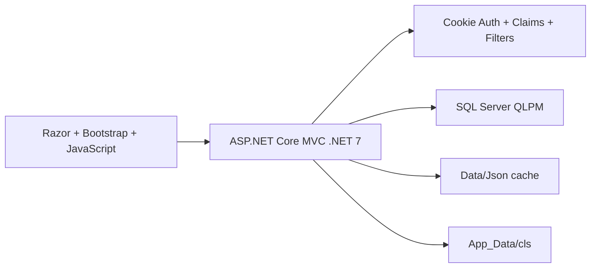

# Kiến trúc QLPM — main

## Runtime

`danh_muc_json_dich_vu` tạo cache từ các bảng trong `QLPM`; `danh_muc_json_worker` chạy nền theo lịch và xử lý các CSKCB có version dirty. Luồng này không kết nối HIS. Mapping HIS trong `Doc/Database/mapping_his_qlpm.md` chỉ là tài liệu tham khảo.

`Program.cs` đăng ký EF Core, cookie authentication, fallback authorization và global filters. Ngữ cảnh `IDCSKCB`/nhân viên lấy từ claims.

Phiếu chỉ định và toa thuốc dùng Razor phía server kết hợp WkHtmlToPdfDotNet để tạo PDF A5. Quyết định và ranh giới dữ liệu được ghi tại [ADR 0001](adr/0001-server-rendered-clinical-pdf.md).

### Quy ước file

Tên file do `tep_tin_dich_vu` chuẩn hóa theo công thức ngắn, không đưa tên bệnh nhân vào tên file:

- tải xuống: `{loai}-{ma}.{ext}` — ví dụ `pcd-vv00215.pdf`, `toa-vv00215.pdf`, `pt-vv00215.pdf`, `kqcls-123.pdf`;
- lưu nội bộ: `{loai}-{id}-{random8}.{ext}`.

Không ép mọi loại file vào cùng một thư mục vật lý vì mức truy cập khác nhau:

- PDF chỉ định/toa/phiếu thu được tạo trong bộ nhớ và stream về trình duyệt, **không lưu bản sao trên server**;
- file kết quả CLS là dữ liệu y tế được bảo vệ, lưu dưới `App_Data/cls/<IDCSKCB>/<IDChiDinhCT>/` và chỉ đọc qua API có quyền;
- logo CSKCB là tài nguyên hiển thị công khai trong ứng dụng, lưu dưới `wwwroot/uploads/cskcb-logo/`;

## Core

`IDVaoVien` là khóa nghiệp vụ của lần khám. Tiếp nhận, sinh hiệu, chẩn đoán, chỉ định, toa thuốc và lịch sử đều bám lượt khám.

`QL_BenhNhan.IDGioiTinh` là cột giới tính vật lý. `DM_DichVu.LoaiKetQua` và `IDFormKQ` là contract CLS common.

## Controller

- `tiep_nhan_controller`: tiếp nhận/công khám/chuyển khám.
- `kham_benh_controller`: khám/lịch sử/kê lại; không chứa API kết quả CLS trùng lặp.
- `phac_do_controller`: CRUD phác đồ.
- `cls_ket_qua_controller`: danh sách chỉ định CLS, xem kết quả và quản lý file kết quả. Không còn import trị số hoặc duyệt/hủy duyệt.
- `he_thong_controller`: nhân viên/tài khoản/vai trò/phân quyền/danh mục. Main không có module Nhật ký hệ thống.

Main không có DSS/AHP/Rule-based.

## CLS

CLS chỉ lưu file kết quả và metadata/đường dẫn dưới `App_Data/cls/<IDCSKCB>/<IDChiDinhCT>/`; mọi định dạng được nhận, tối đa 15 MB. Mỗi chỉ định có tối đa một file hiện hành. STO khóa theo chỉ định, đánh dấu file cũ không hoạt động và ghi lịch sử thay thế trong cùng transaction; API chỉ dọn bytes cũ sau khi commit thành công. Resolver vẫn cho phép đọc/xóa file cũ dưới `App_Data/cls-v2/`. Không trích trị số hoặc lưu kết quả nhập tay.

Các bảng trị số xét nghiệm/form CLS cũ đã bị loại khỏi schema PDF-only.

## Hành vi khi thiếu quyền

Route giao diện MVC được ẩn theo quyền: người dùng đã đăng nhập nhưng không có quyền truy cập trực tiếp URL trang sẽ nhận HTTP 404. API vẫn dùng HTTP 403 khi đã xác thực nhưng thiếu quyền để client xử lý đúng semantics.
