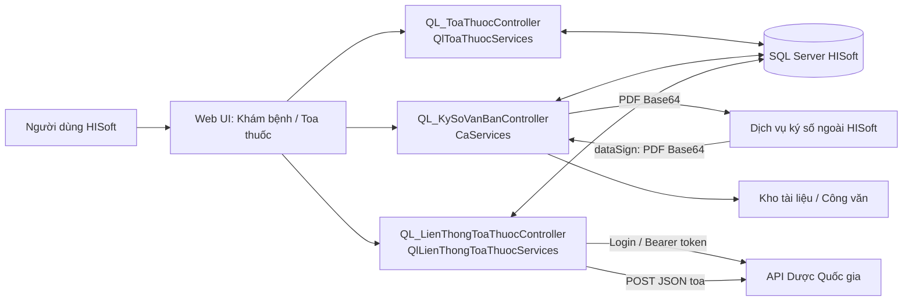
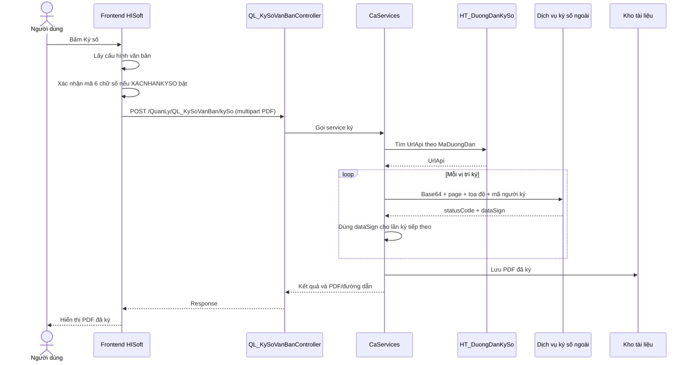
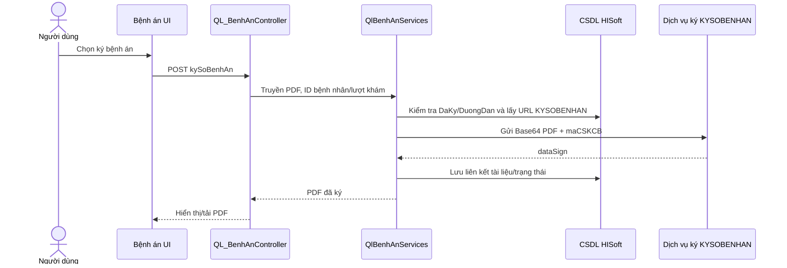
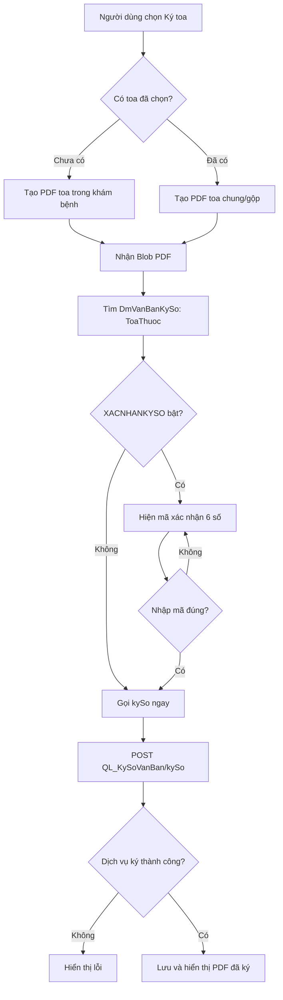
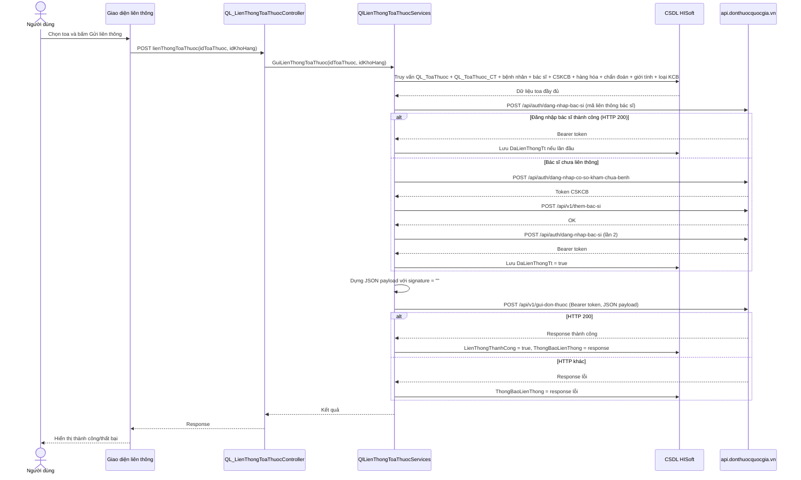
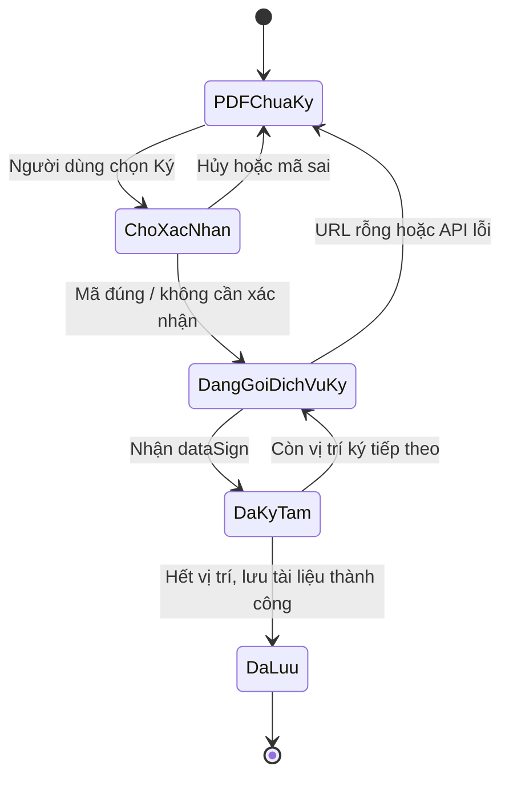
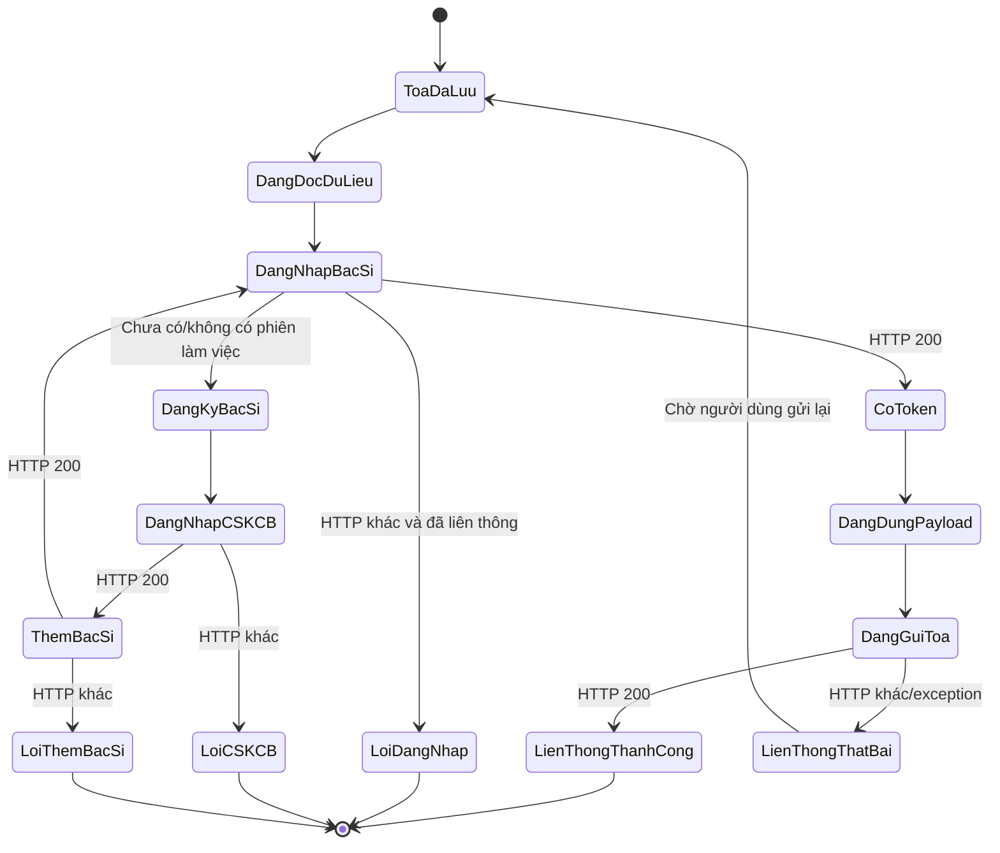
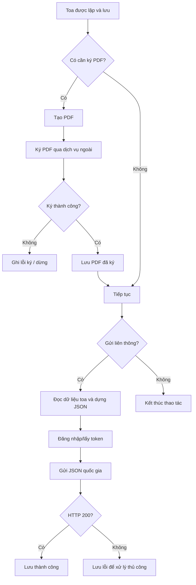
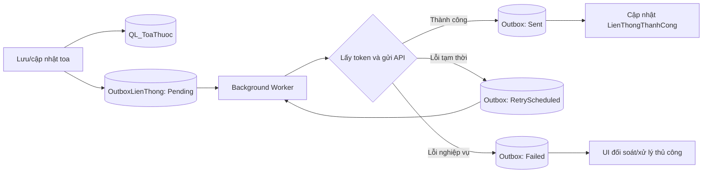

## Mục lục

1. [Tóm tắt điều hành](#1-tóm-tắt-điều-hành)
2. [Phạm vi và phương pháp khảo sát](#2-phạm-vi-và-phương-pháp-khảo-sát)
3. [Kiến trúc tổng thể](#3-kiến-trúc-tổng-thể)
4. [Danh mục source và thành phần](#4-danh-mục-source-và-thành-phần)
5. [Mô hình dữ liệu liên quan](#5-mô-hình-dữ-liệu-liên-quan)
6. [Luồng ký số PDF dùng chung](#6-luồng-ký-số-pdf-dùng-chung)
7. [Luồng ký số bệnh án](#7-luồng-ký-số-bệnh-án)
8. [Luồng ký toa thuốc PDF](#8-luồng-ký-toa-thuốc-pdf)
9. [Luồng liên thông toa thuốc quốc gia](#9-luồng-liên-thông-toa-thuốc-quốc-gia)
10. [So sánh hai cơ chế](#10-so-sánh-hai-cơ-chế)
11. [State machine và activity flow](#11-state-machine-và-activity-flow)
12. [Bảng mapping dữ liệu](#12-bảng-mapping-dữ-liệu)
13. [Bảo mật và rủi ro](#13-bảo-mật-và-rủi-ro)
14. [Retry, transaction và audit](#14-retry-transaction-và-audit)
15. [Khuyến nghị triển khai](#15-khuyến-nghị-triển-khai)
16. [Kết quả kiểm tra build](#16-kết-quả-kiểm-tra-build)
17. [Phụ lục source](#17-phụ-lục-source)
18. [Kết luận](#18-kết-luận)

## 1. Tóm tắt điều hành

HISoft hiện có **hai cơ chế kỹ thuật độc lập**:

1. **Ký số tài liệu/PDF**: HISoft tạo PDF từ bệnh án, toa thuốc hoặc biểu mẫu; gửi PDF Base64 tới dịch vụ ký số bên ngoài; nhận lại PDF đã ký (`dataSign`) và lưu trong kho tài liệu/công văn.
2. **Liên thông toa thuốc quốc gia**: HISoft tập hợp dữ liệu toa, bệnh nhân, thuốc, chẩn đoán và bác sĩ thành JSON; đăng nhập Dược Quốc gia để lấy Bearer token; gửi JSON đến API quốc gia.

### Kết luận cốt lõi

Trong payload liên thông, source hiện tại gán trực tiếp:

```csharp
signature = "";
```

Không có lời gọi nào từ `QlLienThongToaThuocServices` đến `CaServices`, `QlBenhAnServices` hoặc luồng ký PDF chung. Vì vậy:

- PDF đã ký không được dùng làm input cho API liên thông;
- kết quả `dataSign` không được chuyển thành `signature` JSON;
- ký PDF và liên thông đơn là hai thao tác độc lập trong implementation hiện có.

> Báo cáo chỉ khẳng định những gì đọc được trong source. URL ký số thực tế, chứng thư/khóa, và credential runtime nằm trong cơ sở dữ liệu hoặc dịch vụ ngoài nên chưa thể xác minh từ source.

## 2. Phạm vi và phương pháp khảo sát

### Phạm vi

- Ký số PDF/bệnh án/toa thuốc qua `CaServices` và `QlBenhAnServices`.
- Cấu hình URL ký qua entity `HtDuongDanKySo`.
- Luồng frontend ký số chung và ký toa thuốc.
- Liên thông toa thuốc trong `QlLienThongToaThuocServices`.
- Entity toa thuốc, chi tiết toa, kết quả XML và thông tin doanh nghiệp.
- DI/Worker trong `Program.cs` và `Worker.cs`.

### Không thuộc phạm vi đã xác minh

- Giá trị thật của `HT_DuongDanKySo.UrlApi`.
- Nội dung database của `HT_KhoaVanBanKy`, chứng thư số và private key.
- Giao thức nội bộ của dịch vụ ký số bên ngoài HISoft.
- Tài liệu chuẩn API Dược Quốc gia về trường `signature`.
- Runtime traffic, log production và dữ liệu bệnh nhân thực.

### Phương pháp

1. Đọc controller, service, entity, frontend JavaScript và DI registration.
2. Dò các lời gọi `kySo`, `xacNhanKySo`, `KYSO*`, `signature`, `gui-don-thuoc`, token và trạng thái liên thông.
3. Đối chiếu object dựng payload, request HTTP và trường persistence.
4. Chạy build không restore để kiểm tra ảnh hưởng biên dịch; kết quả ghi ở mục 16.

## 3. Kiến trúc tổng thể



### Biên hệ thống

| Vùng | Thành phần | Trách nhiệm |
|---|---|---|
| HISoft UI | JavaScript/jQuery | Tạo PDF, xác nhận người dùng, gọi endpoint nội bộ. |
| HISoft API | Controller + service | Áp dụng nghiệp vụ, lấy cấu hình/dữ liệu, gọi hệ thống ngoài. |
| CSDL HISoft | Entity Framework Core | Lưu toa, trạng thái liên thông, cấu hình URL ký và thông tin cơ sở. |
| Dịch vụ ký ngoài | URL trong `HT_DuongDanKySo.UrlApi` | Ký PDF và trả PDF Base64 đã ký. |
| Dược Quốc gia | `api.donthuocquocgia.vn` | Xác thực CSKCB/bác sĩ và nhận JSON toa. |

## 4. Danh mục source và thành phần

| Nhóm | File tuyệt đối | Nội dung đã xác minh |
|---|---|---|
| Ký PDF chung | `D:\project\DaotaoHIS\HisSoft\Services\ExtenstionServices\CaServices.cs` | Lấy URL ký, gửi Base64 PDF, nhận `dataSign`, lưu file. |
| Ký bệnh án | `D:\project\DaotaoHIS\HisSoft\Services\ManagermentServices\QlBenhAnServices.cs` | Ký bệnh án theo `KYSOBENHAN`, lưu và đọc lại PDF đã ký. |
| Controller bệnh án | `D:\project\DaotaoHIS\HisSoft\Controllers\QL_BenhAnController.cs` | Endpoint ký/xem bệnh án. |
| Controller toa | `D:\project\DaotaoHIS\HisSoft\Controllers\QL_ToaThuocController.cs` | Tạo PDF và lưu toa. |
| Liên thông | `D:\project\DaotaoHIS\HisSoft\Services\ManagermentServices\QlLienThongToaThuocServices.cs` | Login, đăng ký bác sĩ, dựng và gửi JSON. |
| Controller liên thông | `D:\project\DaotaoHIS\HisSoft\Controllers\QL_LienThongToaThuocController.cs` | Endpoint UI liên thông. |
| Frontend ký | `D:\project\DaotaoHIS\HisSoft\wwwroot\dist\js\J0304\QL_KySoVanBan.js` | `xacNhanKySo`, `kySo`, upload PDF. |
| Frontend toa | `D:\project\DaotaoHIS\HisSoft\wwwroot\dist\js\QuanLyJS\QL_ToaThuocDungChung.js` | Sinh PDF toa và gọi ký. |
| Cấu hình ký | `D:\project\DaotaoHIS\HisSoft\Models\Entities\HtDuongDanKySo.cs` | URL API theo `MaDuongDan`. |
| Văn bản ký | `D:\project\DaotaoHIS\HisSoft\Models\Entities\DmVanBanKySo.cs` | Loại văn bản, kích thước, bắt buộc ký. |
| Kết quả ký | `D:\project\DaotaoHIS\HisSoft\Models\ModelsHoTro\SixOsKySo.cs` | `statusCode`, `message`, `dataSign`, `maHoSo`. |
| Đăng ký DI | `D:\project\DaotaoHIS\HisSoft\Program.cs` | Đăng ký `ICaServices`, liên thông và các service. |

## 5. Mô hình dữ liệu liên quan

### 5.1. Toa thuốc

| Entity/bảng | Trường liên quan | Vai trò |
|---|---|---|
| `QlToaThuoc` / `QL_ToaThuoc` | `Id`, `MaToaThuoc`, `NgayKe` | Định danh và thời điểm toa. |
|  | `IdbenhNhan`, `IdvaoVien`, `IdchanDoan`, `IdbacSiKham` | Liên kết bệnh nhân/lượt khám/chẩn đoán/bác sĩ. |
|  | `LienThongThanhCong` | Đã gửi thành công hay chưa. |
|  | `ThongBaoLienThong` | Response/lỗi liên thông. |
| `QlToaThuocCt` / `QL_ToaThuoc_CT` | Hàng hóa, số lượng, đơn vị, cách dùng | Danh sách thuốc gửi quốc gia. |

### 5.2. Ký số

| Entity/bảng | Vai trò |
|---|---|
| `DmVanBanKySo` | Danh mục loại văn bản cần ký, mã `ToaThuoc`/tên/kích thước. |
| `HtDuongDanKySo` | URL API ký theo các mã `KYSOBENHAN`, `KYSOPDFCHUNGSM`,... |
| `HtKhoaVanBanKy` | Cấu hình/khóa văn bản sau ký; cần đối chiếu thêm dữ liệu runtime. |
| `QlKetQuaXml` | Có liên quan tới lưu kết quả XML/trạng thái ký ở các luồng QD130. |
| `QL_BenhAn` | `DaKy`, `DuongDan` và thông tin tài liệu bệnh án. |

### 5.3. Thông tin xác thực liên thông

Thông tin mã/mật khẩu liên thông được lấy từ dữ liệu bác sĩ và thông tin doanh nghiệp. Source đã thấy các trường như `MaLienThongTt`, `MatKhauLienThongTt`, mã CSKCB và mật khẩu CSKCB. Chưa xác minh được dữ liệu thực tế có mã hóa trong database hay không.

## 6. Luồng ký số PDF dùng chung



### Payload chi tiết

```json
{
  "base64": "<PDF_BASE64>",
  "maCSKCB": "<MÃ_CƠ_SỞ_KCB>",
  "page": 1,
  "toaDoX": "<TỌA_ĐỘ_X>",
  "toaDoY": "<TỌA_ĐỘ_Y>",
  "maNguoiKy": "<MÃ_NGƯỜI_KÝ>",
  "kichThuoc": "SM"
}
```

### Quy tắc xử lý response

- Nếu URL rỗng: trả lỗi “Vui lòng cài đặt đường dẫn ký số!”.
- Nếu `statusCode == 200`: lấy `dataSign` làm PDF Base64 mới.
- Nếu lỗi: trả `statusCode`/`message`, không lưu bản ký thành công.
- Sau vòng lặp: decode `dataSign` và chuyển danh sách file cho dịch vụ lưu công văn.

## 7. Luồng ký số bệnh án



Nếu bệnh án đã ký và có đường dẫn lưu, code có thể đọc lại file thay vì gọi dịch vụ ký lần nữa. Thông tin certificate/private key không nằm trong HISoft source đã kiểm tra; khả năng cao do dịch vụ ký ngoài quản lý.

## 8. Luồng ký toa thuốc PDF



Các endpoint tạo PDF được gọi từ frontend toa, sau đó chung quy về `xacNhanKySo(...)`; đây vẫn là ký tài liệu PDF, không phải ký JSON liên thông.

## 9. Luồng liên thông toa thuốc quốc gia

### 9.1. Endpoint HISoft

| HTTP | Đường dẫn | Mục đích |
|---|---|---|
| POST | `/QuanLy/QL_LienThongToaThuoc/taiDanhSach` | Tải danh sách toa cần liên thông. |
| POST | `/QuanLy/QL_LienThongToaThuoc/lienThongToaThuoc` | Gửi toa thuốc lên quốc gia. |
| POST | `/QuanLy/QL_LienThongToaThuoc/xemDuLieuToaThuoc` | Xem JSON payload trước khi gửi. |
| POST | `/QuanLy/QL_LienThongToaThuoc/xemThongBao` | Xem response/lỗi đã lưu. |

### 9.2. Sequence diagram toàn bộ luồng



### 9.3. Cấu trúc JSON payload đầy đủ

```json
{
  "loai_don_thuoc": "<MaLoaiDonThuoc>",
  "ma_don_thuoc": "<MaToaThuoc>",
  "ho_ten_benh_nhan": "<HoTen>",
  "ma_dinh_danh_y_te": "",
  "ma_dinh_danh_cong_dan": "<SoCMND hoặc Cccd>",
  "ngay_sinh_benh_nhan": "<dd/MM/yyyy>",
  "can_nang": 0,
  "gioi_tinh": 1,
  "ma_so_the_bao_hiem_y_te": "<SoTheBHYT>",
  "thong_tin_nguoi_giam_ho": "<TenNguoiGiamHo>",
  "dia_chi": "<DiaChi>",
  "hinh_thuc_dieu_tri": 1,
  "ngay_tai_kham": 0,
  "ngay_gio_ke_don": "<dd/MM/yyyy HH:mm:ss>",
  "loi_dan": "<GhiChu>",
  "signature": "",
  "so_dien_thoai_nguoi_kham_benh": "<SoDienThoai>",
  "thong_tin_don_thuoc": [
    {
      "ma_thuoc": "<MaDQG hoặc MaHoatChat>",
      "biet_duoc": "<TenThuongMai>",
      "ten_thuoc": "<TenHangHoa>",
      "don_vi_tinh": "<TenDVT>",
      "so_luong": 10,
      "cach_dung": "<LieuDung>"
    }
  ],
  "chan_doan": [
    {
      "ma_chan_doan": "<MaICD10>",
      "ten_chan_doan": "<TenBenh>",
      "ket_luan": "<TenBenh>"
    }
  ]
}
```

### 9.4. Endpoint Dược Quốc gia đã xác minh trong source

| Endpoint | Mục đích |
|---|---|
| `POST /api/auth/dang-nhap-bac-si` | Đăng nhập bác sĩ; nhận Bearer token. |
| `POST /api/auth/dang-nhap-co-so-kham-chua-benh` | Đăng nhập CSKCB khi cần thêm bác sĩ. |
| `POST /api/v1/them-bac-si` | Đăng ký bác sĩ mới. |
| `POST /api/v1/gui-don-thuoc` | Gửi toa thuốc. |
| `POST /api/v1/ xoa-bac-si` | Xóa bác sĩ (chú ý khoảng trắng trong URL). |

Tất cả endpoint trên base URL: `https://api.donthuocquocgia.vn`.

### 9.5. Xử lý trạng thái sau gửi

| Trường hợp | Hành động |
|---|---|
| HTTP 200 | `LienThongThanhCong = true`, `ThongBaoLienThong = jsonResult`. |
| HTTP khác/exception | `ThongBaoLienThong = lỗi/response`. Không đổi `LienThongThanhCong`. |
| Đăng nhập bác sĩ thất bại | Trả lỗi "Mã hoặc mật khẩu liên thông bác sĩ có thể sai!". |
| CSKCB thất bại | Trả lỗi "Đăng nhập CSKCB thất bại!". |
| Đăng ký bác sĩ thất bại | Trả lỗi "Đăng ký liên thông bác sĩ thất bại!". |

## 10. So sánh hai cơ chế

| Tiêu chí | Ký số PDF | Liên thông toa thuốc |
|---|---|---|
| **Đầu vào** | PDF (Blob) | JSON toa thuốc |
| **Dịch vụ ngoài** | URL trong `HT_DuongDanKySo.UrlApi` | `api.donthuocquocgia.vn` |
| **Xác thực** | Dịch vụ ký tự quản lý | Bearer token đăng nhập bác sĩ/CSKCB |
| **Kết quả** | `dataSign`: PDF Base64 đã ký | HTTP response và JSON phản hồi |
| **Lưu kết quả** | File/đường dẫn trong tài liệu/công văn | `LienThongThanhCong`, `ThongBaoLienThong` |
| **Trường `signature`** | Không liên quan | Hardcode chuỗi rỗng `""` |
| **Có gọi nhau không** | KHÔNG: `CaServices` không gọi liên thông | KHÔNG: `QlLienThongToaThuocServices` không gọi `CaServices` |
| **Người trigger** | Bác sĩ bấm "Ký" trên PDF | Người dùng bấm "Gửi liên thông" |
| **Retry** | Không có | Không có |
| **Audit** | Không đầy đủ | Không đầy đủ |


## 11. State machine và activity flow

### 11.1. State machine ký PDF



### 11.2. State machine liên thông



### 11.3. Activity flow nghiệp vụ đề xuất/hiện tại



Lưu ý: sơ đồ trên mô tả cả nhánh PDF và liên thông để minh họa nghiệp vụ. Source hiện tại **không có điều kiện bắt buộc** bước `G` trước bước `J` và không truyền PDF đã ký sang payload JSON.

## 12. Bảng mapping dữ liệu

### 12.1. Header toa → JSON quốc gia

| Nguồn HISoft | Trường JSON | Ghi chú |
|---|---|---|
| Mã toa | `ma_don_thuoc` | Mã định danh đơn. |
| Loại toa | `loai_don_thuoc` | Lấy từ loại đơn/loại kê. |
| Bệnh nhân | `ho_ten_benh_nhan` | Họ tên người bệnh. |
| CCCD/định danh | `ma_dinh_danh_cong_dan` | Có thể rỗng tùy dữ liệu. |
| Ngày sinh | `ngay_sinh_benh_nhan` | Format được dựng trong service. |
| Giới tính | `gioi_tinh` | Mapping từ danh mục giới tính. |
| BHYT | `ma_so_the_bao_hiem_y_te` | Số thẻ nếu có. |
| Địa chỉ | `dia_chi` | Thông tin liên hệ. |
| Cân nặng | `can_nang` | Lấy từ lượt khám nếu có. |
| Ngày tái khám | `ngay_tai_kham` | Có thể là giá trị mặc định nếu không có. |
| Lời dặn | `loi_dan` | Lấy từ ghi chú toa. |
| Số điện thoại | `so_dien_thoai_nguoi_kham_benh` | Theo thông tin bệnh nhân/khám. |
| Chữ ký | `signature` | Hiện tại là `""`. |

### 12.2. Chi tiết thuốc → `thong_tin_don_thuoc`

| Nguồn HISoft | Trường JSON | Ghi chú |
|---|---|---|
| Mã hàng hóa/thuốc | `ma_thuoc` | Mapping mã thuốc quốc gia/danh mục. |
| Tên thương mại | `biet_duoc` | Biệt dược nếu có. |
| Tên hàng hóa | `ten_thuoc` | Tên thuốc. |
| Đơn vị tính | `don_vi_tinh` | Đơn vị dùng. |
| Tổng số lượng | `so_luong` | Số lượng kê. |
| Liều/cách dùng | `cach_dung` | Có thể ghép sáng/trưa/chiều/tối và hướng dẫn khác. |

### 12.3. Chẩn đoán → `chan_doan`

| Nguồn HISoft | Trường JSON |
|---|---|
| Mã ICD/YHCT | `ma_chan_doan` |
| Tên bệnh | `ten_chan_doan` |
| Kết luận | `ket_luan` |

## 13. Bảo mật và rủi ro

### 13.1. Chữ ký liên thông đang rỗng — mức cao

`signature` được tạo rỗng. Cần xác nhận với đặc tả Dược Quốc gia:

- Có bắt buộc ký payload hay không?
- Ký toàn bộ JSON hay phần nào?
- Canonicalization/encoding như thế nào?
- Thuật toán và kích thước khóa?
- Chứng thư do đơn vị nào cấp?
- Chữ ký là Base64, XML Signature, JWS hay format riêng?
- Chữ ký có quan hệ với PDF hiển thị cho bệnh nhân hay không?

Không được tự lấy `dataSign` của PDF làm `signature` nếu tài liệu API không quy định như vậy.

### 13.2. Credential và token — mức cao

Các trường mật khẩu liên thông được dùng để đăng nhập API. Cần kiểm tra:

- mật khẩu có mã hóa khi lưu không;
- quyền đọc entity trong ứng dụng;
- có log request chứa password/token không;
- token có bị lưu lâu hơn cần thiết không;
- có phân quyền thay đổi mã liên thông không.

### 13.3. Base64 PDF — mức cao/trung bình

PDF bệnh án và toa có dữ liệu sức khỏe cá nhân. Việc gửi Base64 tới dịch vụ ngoài cần có:

- HTTPS hợp lệ và kiểm tra chứng thư;
- hợp đồng/xác định bên xử lý dữ liệu;
- log không ghi body Base64;
- giới hạn kích thước request;
- timeout và xử lý lỗi không làm lộ dữ liệu.

### 13.4. Injection và dữ liệu đầu vào — mức trung bình

Payload lấy nhiều dữ liệu từ database và được serialize JSON. Cần tiếp tục kiểm tra:

- validate mã thuốc, số lượng, ngày tháng;
- encode đúng Unicode;
- không nối chuỗi JSON thủ công;
- không đưa thông báo API chứa dữ liệu nhạy cảm vào UI không lọc.

### 13.5. Gửi trùng và idempotency — mức trung bình

Source chưa thấy idempotency key hoặc mã giao dịch nội bộ. Người dùng có thể gửi lại sau lỗi mạng trong khi API quốc gia đã nhận request trước đó nhưng response bị mất. Cần lưu request ID/hash và xử lý đối soát.


## 14. Retry, transaction và audit

### 14.1. Retry hiện tại

Không phát hiện cơ chế retry tự động cho API Dược Quốc gia hoặc dịch vụ ký số:

- Không có hàng đợi/outbox cho toa thất bại.
- Không có `retry_count`, `last_attempt_at`, `next_retry_at` hoặc phân loại lỗi.
- Không thấy `IHttpClientFactory`, Polly retry hay circuit breaker trong các service đã khảo sát.
- `Worker.cs` không phải worker retry liên thông và `AddHostedService<Worker>()` trong `Program.cs` đang bị comment.

### 14.2. Transaction

`CaServices` mở transaction khi context chưa có transaction; nếu lỗi, code rollback. Đây là hướng xử lý đúng cho phần lưu tài liệu nội bộ, nhưng giao dịch với hệ thống ngoài không thể rollback theo transaction SQL.

Trong luồng liên thông cần xác minh kỹ `luuDaLienThong`: nhánh exception có dấu hiệu gọi `CommitAsync()` thay vì `RollbackAsync()`. Nếu đúng, đây là lỗi cần sửa để bảo toàn tính nhất quán dữ liệu.

### 14.3. Mô hình outbox đề xuất



Các trường tối thiểu đề xuất:

| Trường | Mục đích |
|---|---|
| `Id`, `IdToaThuoc` | Định danh sự kiện và toa. |
| `PayloadJson`, `PayloadHash` | Đối soát dữ liệu đã gửi. |
| `Status` | Pending, Processing, Sent, RetryScheduled, Failed. |
| `AttemptCount`, `LastAttemptAt`, `NextRetryAt` | Điều khiển retry. |
| `ExternalTransactionId`, `HttpStatusCode` | Đối soát hệ thống quốc gia. |
| `ResponseBody` | Lưu response đã che thông tin nhạy cảm nếu cần. |
| `CreatedBy`, `SentBy`, `CreatedAt`, `SentAt` | Audit người và thời điểm. |

### 14.4. Audit tối thiểu cho ký số

| Sự kiện | Thông tin cần lưu |
|---|---|
| Tạo PDF | Mã tài liệu/toa/bệnh án, phiên bản dữ liệu, hash PDF trước ký. |
| Gửi ký | Người yêu cầu, thời gian, URL service không chứa secret, vị trí ký. |
| Ký thành công | Mã hồ sơ, hash PDF sau ký, đường dẫn file, người ký. |
| Ký lỗi | Mã lỗi, message đã lọc dữ liệu nhạy cảm, thời gian. |
| Gửi liên thông | Hash payload, token identity không phải token thật, mã giao dịch ngoài. |

## 15. Khuyến nghị triển khai theo ưu tiên

### Ưu tiên 1 — pháp lý và tính đúng đắn

1. Thu thập tài liệu chuẩn API Dược Quốc gia liên quan `signature`.
2. Xác định liệu payload phải ký hay chỉ cần ký PDF lưu nội bộ.
3. Nếu phải ký payload: triển khai module ký JSON/XML/JWS đúng chuẩn và quản lý certificate/key tách biệt.
4. Ràng buộc phiên bản toa: sau khi ký/gửi, lưu hash dữ liệu và không cho sửa âm thầm.

### Ưu tiên 2 — độ tin cậy tích hợp

1. Áp dụng outbox, background worker và retry exponential backoff.
2. Dùng idempotency key/mã đối soát để tránh gửi trùng.
3. Dùng `IHttpClientFactory` với typed clients cho Dược Quốc gia và dịch vụ ký.
4. Cấu hình timeout, cancellation token, retry lỗi tạm thời và circuit breaker.
5. Phân loại lỗi xác thực, validation, timeout, HTTP 5xx và lỗi business.

### Ưu tiên 3 — bảo mật và vận hành

1. Mã hóa credential tại rest; hạn chế quyền đọc/cập nhật.
2. Không log Base64 PDF, password hoặc Bearer token.
3. Bổ sung audit log bất biến/tách bảng nghiệp vụ.
4. Giới hạn dung lượng upload PDF và kiểm tra MIME type.
5. Theo dõi dashboard pending, failed, retry, latency và tỷ lệ lỗi.

### Ưu tiên 4 — sửa lỗi source cần kiểm tra

1. Xác minh `CommitAsync()` trong catch của `luuDaLienThong` thành rollback nếu đúng.
2. Xác minh URL `/api/v1/ xoa-bac-si`; loại bỏ khoảng trắng nếu là lỗi typo.
3. Xem lại nullable warning để giảm nguy cơ `NullReferenceException` trong luồng tích hợp.


## 16. Kết quả kiểm tra build

Đã chạy:

```powershell
dotnet build "D:\project\DaotaoHIS\HisSoft\HisSoft.csproj" --no-restore --verbosity:minimal
```

Build không hoàn tất do executable đang chạy giữ file:

```text
D:\project\DaotaoHIS\HisSoft\bin\Debug\net7.0\HisSoft.exe
Process: HisSoft.exe (PID 13088)
```

Kết quả cũng có nhiều warning nullable/reference tồn tại sẵn. Lỗi build ghi nhận trong lần kiểm tra là file lock; chưa nên kết luận source không compile được nếu dừng ứng dụng và build lại sạch.

## 17. Phụ lục source và dấu vết xác minh

### 17.1. Dấu vết ký PDF

| Source | Dấu vết |
|---|---|
| `CaServices.cs` | `MaDuongDan == "KYSOPDFCHUNGSM"`; POST payload Base64; kiểm tra `statusCode == 200`; dùng `dataSign`; lưu bằng `chuyenDanhSachCongVan`. |
| `QlBenhAnServices.cs` | Dùng `KYSOBENHAN`, thực hiện ký PDF bệnh án. |
| `QL_KySoVanBan.js` | `xacNhanKySo`; POST `/QuanLy/QL_KySoVanBan/kySo`; FormData gồm file/tên/idvv/idbn/kích thước/bắt buộc. |
| `QL_ToaThuocDungChung.js` | Nút `#kySoToaThuoc`; tạo PDF, gọi `xacNhanKySo`. |

### 17.2. Dấu vết liên thông

| Source | Dấu vết |
|---|---|
| `QlLienThongToaThuocServices.cs` | Đăng nhập bác sĩ/CSKCB, thêm bác sĩ, `https://api.donthuocquocgia.vn/api/v1/gui-don-thuoc`. |
| `QlLienThongToaThuocServices.cs` | Object payload có `signature = ""`. |
| `QlLienThongToaThuocServices.cs` | HTTP 200 cập nhật `LienThongThanhCong`; response lưu `ThongBaoLienThong`. |
| `QL_LienThongToaThuocController.cs` | Endpoint tải danh sách, gửi, xem payload và xem thông báo. |
| `Program.cs` | Đăng ký `IQlLienThongToaThuocServices` và `ICaServices`. |

### 17.3. Hạn chế

- Không truy vấn database production hoặc đọc secret runtime.
- Không gửi request thật tới API ký hoặc Dược Quốc gia.
- Không xác thực tài liệu pháp lý/chuẩn kỹ thuật bên ngoài về `signature`.
- Không chỉnh sửa source, database schema hoặc cấu hình trong quá trình phân tích.

## 18. Kết luận

HISoft đã triển khai được luồng ký PDF qua dịch vụ ngoài và luồng gửi JSON toa thuốc qua Dược Quốc gia. Hai luồng không được nối với nhau ở source hiện tại. Dấu hiệu rõ nhất là `signature = ""` trong JSON liên thông và không có lời gọi từ service liên thông tới service ký.

Do đó, việc xác nhận yêu cầu chính thức của trường `signature` là bước bắt buộc trước khi kết luận hệ thống đã đáp ứng yêu cầu ký số e-prescription. Nếu chữ ký dữ liệu là bắt buộc, hệ thống cần bổ sung cơ chế ký payload theo đúng đặc tả, cùng với outbox/retry, audit, idempotency và quản trị credential an toàn.

