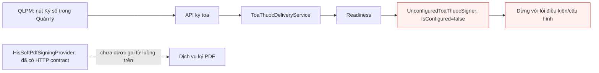
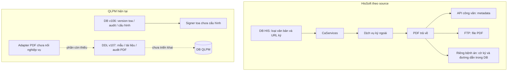
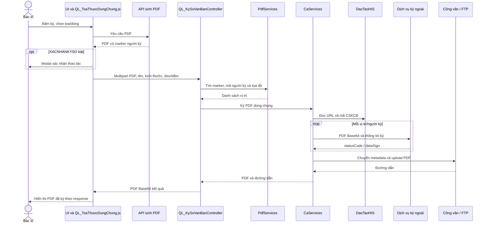
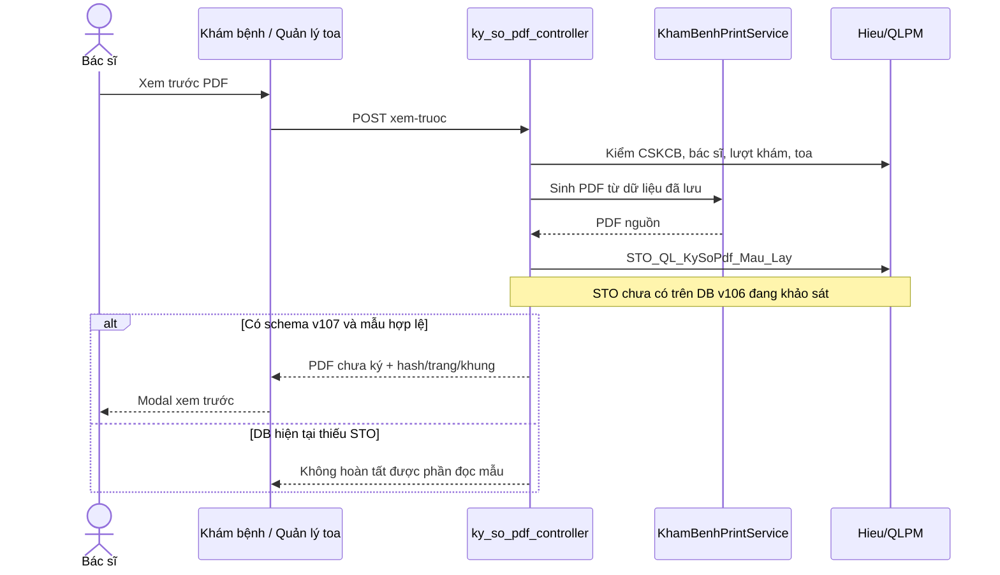
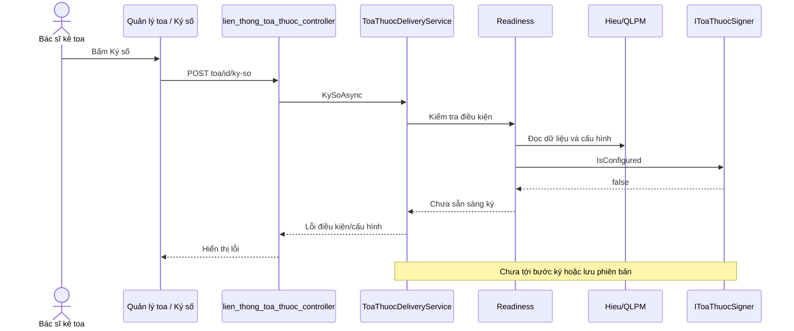
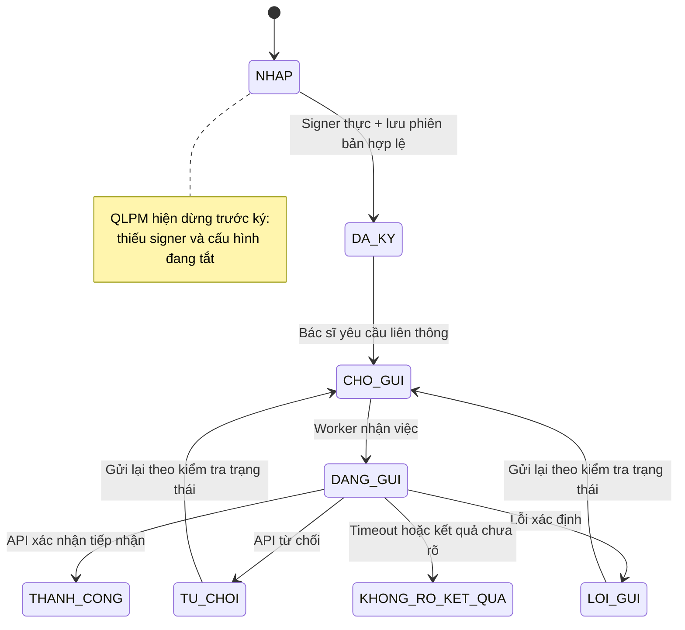
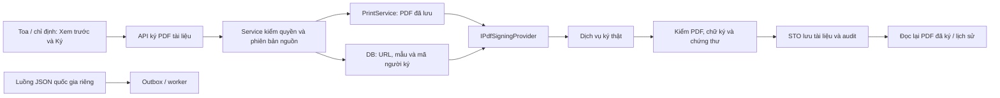

# So sánh ký số QLPM với HisSoft: UI, code, DB và luồng xử lý

Ngày khảo sát: **12/10/2026**.

| Hệ thống | Source khảo sát | Database đã đọc trực tiếp |
|---|---|---|
| QLPM | `Hieu_12/10_1`, HEAD `95f13ec`, bao gồm thay đổi local vừa gỡ khóa DryRun | Server `Hieu`, DB `QLPM`, schema v106 |
| HisSoft | `Hieu_01/10`, HEAD `62ed40e6` | Server `SIXOS`, endpoint cấu hình `118.69.34.247,8392`, DB `DaoTaoHIS` |

## 1. Kết luận và tỷ lệ đánh giá

**QLPM chưa có luồng ký PDF hoàn chỉnh giống HisSoft. Mức chuẩn bị chức năng/kiến trúc hiện tại ước lượng khoảng 40%.** Điểm này không phải tỷ lệ code trùng nhau, độ giống giao diện bằng ảnh, hay tỷ lệ giao dịch ký thành công.

QLPM đã có sinh PDF, UI xem trước, cấu hình khung ký trong source, adapter HTTP theo hợp đồng PDF của HIS, nền tảng phiên bản toa/audit và các kiểm tra quyền. Những phần nối quyết định còn thiếu:

1. **Adapter PDF chưa được gọi từ một luồng ký nghiệp vụ.** Có đăng ký `IPdfSigningProvider`, nhưng chưa có controller/service nghiệp vụ gọi `KyPdfAsync`; lời gọi trong harness chỉ là test.
2. **Luồng ký toa đang dùng `UnconfiguredToaThuocSigner`.** `IsConfigured = false`; readiness không cho ký. Interface này đòi cả chữ ký JSON và PDF, khác với ký PDF dùng chung của HIS.
3. **DB thật chưa có v107.** Thiếu ba bảng PDF và ba STO mẫu ký. Vì vậy ngay cả xem trước có khung ký cũng chưa đủ phụ thuộc DB trên môi trường hiện tại.
4. **Cấu hình thực tế đang tắt và để trống URL ký.** CSKCB 2 đang TEST, `KySoHieuLuc = false`, `LienThongHieuLuc = false`; chưa có cấu hình bác sĩ liên thông.

HisSoft có chuỗi xử lý trong source: **nút ký → sinh PDF → tìm người/vị trí ký trong PDF → gọi dịch vụ ký → nhận PDF → chuyển công văn/FTP → hiển thị PDF đã ký**. QLPM mới có các đoạn riêng; chưa nối thành chuỗi tương đương.

**Khả năng ký thật trên QLPM theo code + DB hiện tại: chưa sẵn sàng.** Chưa thực hiện một giao dịch ký thật trên QLPM hoặc HisSoft trong khảo sát; không suy ra HisSoft đã ký thành công chỉ từ việc có code và URL cấu hình.

### 1.1. Cách tính 40%

Chấm theo mức đáp ứng chức năng tham chiếu, dùng thang 0/25/50/75/100: thiếu, mới có phần chuẩn bị, có một phần triển khai, đã nối luồng nhưng còn xác minh, hoặc đủ đường code và schema cần thiết. Đây là **ước lượng kỹ thuật có trọng số**, không phải đo tự động hay cam kết vận hành.

| Lớp | Trọng số | Mức đáp ứng ước lượng | Điểm quy đổi | Căn cứ |
|---|---:|---:|---:|---|
| UI chức năng | 20 | 50% | 10 | Có xem trước, cấu hình và nút ký; chưa có trải nghiệm nhận/lưu kết quả ký hoàn chỉnh |
| Code/adapter | 20 | 50% | 10 | Có adapter PDF và endpoint ký toa; adapter PDF chưa được nối, signer toa vẫn thiếu |
| DB/cấu hình | 20 | 50% | 10 | Đã có version/audit/cấu hình toa; v107 chưa cài, cấu hình ký đang tắt |
| Luồng từ đầu đến cuối | 25 | 25% | 6,25 | Có phần sinh PDF và kiểm tra dữ liệu; chưa đi qua dịch vụ ký/lưu/đọc lại |
| Toa và chỉ định trong phạm vi QLPM | 15 | 25% | 3,75 | Hai loại PDF có xem trước; chỉ định chưa có endpoint ký/lưu, toa chưa có signer thực |
| **Tổng** | **100** | | **40/100** | |

UI 50% ở đây là **độ đáp ứng thao tác**, không phải giống màu, bố cục hoặc kích thước màn hình. Không tính các bệnh án/biểu mẫu nội trú ngoài phạm vi QLPM thành yêu cầu bắt buộc chỉ để nâng tỷ lệ giống HIS.

### 1.2. Mức bằng chứng

| Nội dung | Mức xác minh |
|---|---|
| View, JavaScript, endpoint, service, DI | Đã đọc source hiện tại của cả hai hệ thống |
| DB/schema/cấu hình/số lượng bản ghi | Đã đọc trực tiếp hai DB; chỉ truy vấn đọc |
| Build và harness sau gỡ khóa | Lượt thực hiện trước: build Release 0 lỗi, JS hợp lệ, harness HTTP giả đạt |
| UI đăng nhập/render | Chưa chạy so sánh hai màn hình bằng trình duyệt |
| Chữ ký thật, chứng thư, PDF đã ký | Chưa gọi dịch vụ ký, chưa xác minh mật mã |
| FTP/dịch vụ công văn bên HIS | Đã đọc đường code; chưa upload/download thử |
| Bản ứng dụng đang chạy | Không xác nhận đã restart/deploy source vừa sửa |

## 2. Hai cơ chế ký cần phân biệt

| Cơ chế | HisSoft | QLPM hiện tại |
|---|---|---|
| Ký PDF tài liệu | `CaServices.kySoPDFDungChung`: nhận PDF, ký theo marker và lưu ngoài qua công văn/FTP | `HisSoftPdfSigningProvider` có contract tương tự, nhưng chưa nối action ký tài liệu |
| Ký dữ liệu JSON quốc gia | Luồng liên thông đã đọc có `signature = ""`; không phải bằng chứng ký JSON | `IToaThuocSigner` đòi chữ ký dữ liệu + JSON đã ký + PDF; implementation đang chưa cấu hình |
| Gửi toa quốc gia | Client/luồng liên thông riêng | Client + outbox + worker riêng, gỡ khóa toàn cục nhưng cần cấu hình và toa đã ký |

**Không nên buộc ký PDF QLPM phải hoàn thành ký JSON quốc gia mới dùng được**, nếu mục tiêu là ký toa/chỉ định PDF giống HIS. Đây là điểm cần tách thiết kế hiện tại: ký tài liệu PDF và liên thông JSON là hai luồng có hợp đồng khác nhau.

## 3. So sánh UI và thao tác người dùng

### 3.1. Bảng đối chiếu

| Thao tác | HisSoft theo source | QLPM theo source hiện tại | Mức tương đương |
|---|---|---|---|
| Ký tại khu vực toa | `#kySoToaThuoc`, các nút toa gộp/YHCT/VTYT gọi luồng ký chung | Khám bệnh đang là **Xem trước ký**; trang Quản lý có **Ký số** | Một phần |
| Chọn loại tài liệu | `DM_VanBanKySo`, mã loại, kích thước, bắt buộc ký | Toa/chỉ định; cấu hình mẫu A5 theo CSKCB | Một phần, phạm vi khác |
| Xem PDF trước ký | Sinh PDF theo toa/chẩn đoán/các dòng chọn | Endpoint xem trước lấy dữ liệu đã lưu; có hash, trang và khung ký | Có nền tảng tương ứng |
| Xác nhận thao tác ký | `XACNHANKYSO` điều khiển modal mã sáu số | Chưa có modal xác nhận ký tương ứng trong luồng đang đọc | Chưa có |
| Thực hiện ký | JS gửi PDF multipart lên API ký chung | Trang Quản lý gửi ID toa lên API; bị thiếu signer | Chưa tương đương hoạt động |
| Ký chỉ định nội bộ/gửi ngoài | Mẫu PDF CLS có marker người ký trong nhiều biểu mẫu | Có chọn nhóm và xem trước hai PDF; chưa có action ký chỉ định | Một phần |
| Hiển thị kết quả ký | Decode Base64 trả về, embed PDF, thông báo thành công | Có endpoint tải PDF theo phiên bản toa, nhưng DB chưa có bản ký | Có khung đọc lại, chưa có kết quả |
| Lịch sử tài liệu | Đường công văn/FTP; bệnh án lưu cờ ký và đường dẫn | Nền tảng version/audit toa; tài liệu PDF chung v107 mới có DDL | Khác thiết kế, chưa hoàn tất |

Mã sáu số trong HIS được tạo/hiển thị ở frontend để xác nhận thao tác; không phải OTP do nhà cung cấp chứng thư gửi, và không thay thế chữ ký số.

### 3.2. Các route QLPM

| Route/API | Tác dụng hiện tại |
|---|---|
| `/kham_benh` | Xem trước ký PDF toa/chỉ định trên hồ sơ đã lưu |
| `/lien_thong_toa_thuoc?cong_doan=ky_so` | Danh sách toa, kiểm tra, xem trước, action ký nghiệp vụ |
| `/lien_thong_toa_thuoc?cong_doan=lien_thong` | Xem payload, mô phỏng, xếp hàng gửi/gửi lại theo trạng thái |
| `/he_thong/lien_thong_toa_thuoc` | Cấu hình ký/gửi, bác sĩ và khung ký PDF |
| `POST /api/ky_so_pdf/xem-truoc` | Trả PDF nguồn; `X-QLPM-PDF-Da-Ky: false`; không ký/lưu bản ký |
| `POST /api/lien_thong_toa_thuoc/{id}/ky-so` | Gọi `ToaThuocDeliveryService.KySoAsync`; hiện không có signer thực |
| `GET /api/lien_thong_toa_thuoc/{id}/phien-ban/{versionId}/pdf` | Đọc `QL_ToaThuoc_PhienBan.PdfDaKy` nếu có |

## 4. So sánh code và hợp đồng dịch vụ

### 4.1. Người ký và vị trí ký

**HisSoft:** mẫu PDF đặt marker dạng `{{VKSTuDong}-{MaNhanVien}}`. `PdfServices.FindTextLocations` tìm marker, lấy mã người ký, số trang, tọa độ bounding box. `CaServices` lần lượt ký qua các vị trí; PDF của lượt trước làm đầu vào lượt sau.

**QLPM:** `PdfSigningRequest` đã có `MaCskcb`, `MaNguoiKy`, `TrangKy`, X/Y và kích thước. Khung ký A5 nằm trong migration v107. Chưa có service nghiệp vụ lấy `DM_NhanVien.MaNhanVien`, đọc mẫu ký rồi dựng request và gọi adapter. Chưa có vòng lặp ký nhiều người/vị trí tương tự HIS.

DB QLPM hiện có **16 nhân viên mã `NV0009`**, Admin giữ mã `Admin`. Đây là dữ liệu đã sửa theo yêu cầu; nó không chứng minh có chứng thư tương ứng, không tự nối `MaNhanVien` vào adapter và không phân biệt người ký bằng chứng thư cá nhân.

### 4.2. Payload PDF

| Trường | HisSoft | QLPM adapter |
|---|---|---|
| `base64` | PDF Base64, cập nhật sau mỗi chữ ký | PDF nguồn Base64 |
| `maCSKCB` | Từ `ThongTinDoanhNghiep` | Từ `PdfSigningRequest.MaCskcb` |
| `page` | Trang tìm thấy marker | Trang truyền vào request |
| `toaDoX`, `toaDoY` | Số nguyên từ bounding box | Serialize decimal thành **chuỗi** invariant |
| `maNguoiKy` | Mã lấy từ marker PDF | Chuỗi truyền vào request, chưa có orchestration tự map |
| `kichThuoc` | Theo loại văn bản | Mặc định `SM` hoặc tham số request |

Tên trường giống HIS nhưng **kiểu tọa độ đang khác**. Chưa xác minh provider chấp nhận chuỗi thay vì số. Test HTTP giả không thay thế việc kiểm tra hợp đồng provider thực tế.

### 4.3. Response và xác minh chữ ký

- HIS đọc `statusCode`, `dataSign`, decode rồi chuyển file công văn/FTP. Luồng đã đọc không có bước xác minh PKCS#7/PAdES/chuỗi chứng thư ngay tại C# trước lưu.
- QLPM adapter kiểm HTTP thành công, status 200, Base64, PDF header, kích thước, `/ByteRange` và `/SubFilter`.
- Kiểm tra hai từ khóa PDF của QLPM là **kiểm tra cấu trúc sơ bộ**, không phải xác minh mật mã/chứng thư. Không chấm tính năng này là “đã xác thực chữ ký thật”.
- Adapter QLPM trả byte PDF + mã hồ sơ + nhãn provider. Chưa có thông tin chứng thư được trích/xác minh để điền đầy đủ `SerialChungThu` trong kho tài liệu.

### 4.4. Điểm nối đang thiếu

`IPdfSigningProvider` và `IToaThuocSigner` là hai interface khác nhau. Đăng ký adapter PDF trong DI không tự thay implementation signer toa.

## 5. Database: phần đã có và phần mới chỉ có trong migration

### 5.1. QLPM live

| Object | Có trên `Hieu/QLPM`? | Ghi chú |
|---|---|---|
| `HT_LienThongToaThuoc_CauHinh` | Có | CSKCB 2: TEST, ký/gửi tắt, URL ký dữ liệu/PDF trống |
| `HT_LienThongToaThuoc_BacSi` | Có | **0 bản ghi** |
| `QL_ToaThuoc_PhienBan` | Có | **0 bản ghi** |
| `QL_ToaThuoc_LanGui` | Có | **0 bản ghi**, không có `CHO_GUI` |
| `QL_ToaThuoc_Audit` | Có | **0 bản ghi** |
| `STO_QL_ToaThuoc_LuuPhienBanDaKy` | Có | Đã đọc định nghĩa thực tế |
| `STO_QL_ToaThuoc_XepHangGui`, `STO_QL_ToaThuoc_BatDauGui` | Có | Đã đọc định nghĩa thực tế |
| `HT_KySoPdf_Mau` | **Chưa có** | DDL trong migration v107 |
| `QL_KySoPdf_TaiLieu` | **Chưa có** | DDL trong migration v107 |
| `QL_KySoPdf_Audit` | **Chưa có** | DDL trong migration v107 |
| Ba STO `STO_QL_KySoPdf_Mau_DanhSach/Lay/Luu` | **Chưa có** | API mẫu/xem trước đang phụ thuộc chúng |

Không coi DB có bảng phiên bản toa là đã có dữ liệu ký thật; snapshot đang có 0 phiên bản. Không coi file migration là schema đã triển khai.

### 5.2. HisSoft live và phần lưu ngoài DB HIS

| Object/đích lưu | Kết quả |
|---|---|
| `DM_VanBanKySo` | Có, 17 dòng; loại văn bản, kích thước, bắt buộc, active |
| `HT_DuongDanKySo` | Có, 8 dòng; các đường ký có URL và active trong snapshot |
| `HT_KhoaVanBanKy` | Có, 6 dòng; chính sách khóa văn bản theo bảng |
| `QL_BenhAn` | Code ký cập nhật `DaKy`, `DuongDan`, `IDNhanVienKy` |
| PDF đã ký | Service chuyển sang công văn và upload FTP, không lưu blob PDF chung trong các bảng ký local đã kiểm tra |
| DB của dịch vụ công văn | Chưa truy cập/khảo sát; không mô tả schema của dịch vụ ngoài như schema `DaoTaoHIS` |

Trong nhánh `chuyenDanhSachCongVan`, HIS gửi metadata bệnh nhân/lượt khám qua API công văn, rồi ghi file lên FTP. Transaction EF không bao trùm giao dịch HTTP/FTP; việc commit DB không làm cho cả chuỗi tài nguyên ngoài trở thành atomic.

### 5.3. Quy tắc STO hiện có của QLPM

`STO_QL_ToaThuoc_LuuPhienBanDaKy` kiểm:

- Toa thuộc CSKCB; người ký là bác sĩ kê đơn; tài khoản có quyền ký tại cơ sở.
- Trạng thái cho phép ký và `PhienBanLamSang` vẫn khớp phiên bản nguồn.
- PDF không rỗng, chữ ký dữ liệu không rỗng.
- Có transaction và `UPDLOCK/HOLDLOCK`; tăng số phiên bản, hết hiệu lực các phiên bản trước, lưu PDF/JSON/hash/provider/serial, cập nhật `DA_KY`, ghi audit.

Đây là nền tảng dữ liệu tốt cho toa quốc gia, nhưng **chưa phù hợp làm STO ký PDF chung trực tiếp**: nó đòi chữ ký dữ liệu JSON và gắn với đầu toa, không phục vụ một phiếu chỉ định PDF độc lập.

### 5.4. Hai mô hình lưu trữ

QLPM không cần sao chép cách lưu FTP của HIS để đạt cùng kết quả nghiệp vụ. Có thể dùng kho PDF trong DB hoặc kho file khác, miễn có lưu bền vững, quyền đọc, phiên bản và kiểm tra tính toàn vẹn.

## 6. Sơ đồ luồng HisSoft theo source

Sơ đồ này xác nhận **đường code có đủ các bước**, không chứng minh lần gọi thật đã thành công. HIS vẫn phụ thuộc dịch vụ ký, cấu hình mã cơ sở/người ký, API công văn và FTP.

## 7. Sơ đồ QLPM hiện tại và điểm dừng

### 7.1. Xem trước PDF

Nhánh lỗi thiếu STO được suy ra từ dependency source + catalog DB; chưa gọi API đăng nhập để ghi nhận mã lỗi HTTP thực tế. Không mô tả đây là UI đã thử và quan sát thành công.

### 7.2. Ký toa nghiệp vụ

Gỡ DryRun đã bỏ khóa toàn cục, nhưng không tạo implementation signer, không điền URL và không triển khai migration.

## 8. Các trạng thái ký và liên thông

Đây là sơ đồ các trạng thái/chuyển chính đã thấy trong source/STO, không liệt kê toàn bộ tình huống hết hiệu lực hay sửa dữ liệu. Worker hiện đã gỡ khóa; snapshot DB chưa có bản ký hoặc yêu cầu gửi nào.

## 9. Phần giống, khác và còn thiếu

| Nhóm | Đánh giá |
|---|---|
| Giống về ý tưởng | Sinh PDF từ nghiệp vụ, mã CSKCB/người ký, trang/toạ độ, HTTP Base64, hiển thị/đọc lại kết quả |
| Giống ở contract nhưng chưa chứng minh tương thích | Tên trường JSON adapter PDF; còn khác kiểu tọa độ và chưa test provider |
| QLPM đã có kiểm soát riêng | Tenant/quyền bác sĩ, version nguồn, STO kiểm trạng thái, hash, audit và idempotency gửi |
| Khác cách chọn người/vị trí ký | HIS tìm marker trong PDF và lặp nhiều vị trí; QLPM dự kiến request + mẫu CSKCB |
| Khác persistence | HIS dùng công văn/FTP, riêng bệnh án có cờ/đường dẫn; QLPM dùng phiên bản toa và đề xuất kho PDF v107 |
| Thiếu quyết định | Service ký PDF chung nối endpoint → adapter → validate → lưu → trả kết quả |
| Thiếu triển khai DB | Schema và STO v107 trên môi trường đang kiểm tra |
| Thiếu chức năng chỉ định | Endpoint ký/lưu/đọc lại theo nhóm nội bộ/gửi ngoài và phiên bản |
| Chưa xác minh vận hành | Chứng thư, provider, PDF ký thật, API quốc gia, giao diện đăng nhập |

Không chấm QLPM thấp vì nó không dùng cùng tên controller/table như HIS. Điểm thấp chủ yếu do **thiếu đường chạy hoàn chỉnh**, không phải vì thiết kế lưu trữ khác nhau.

## 10. Hướng làm để đạt tương đương trong phạm vi QLPM

Các hạng mục sau là đề xuất; **chưa triển khai trong lần lập báo cáo này**.

### P0. Hoàn tất ký PDF chung

1. Triển khai/verify schema v107 trên đúng DB, có backup và rollback.
2. Tạo service ký tài liệu PDF, dùng `IPdfSigningProvider`; lấy `MaNguoiKy` từ nhân viên, mã CSKCB, URL và mẫu ký từ đúng cơ sở.
3. Nối action ký toa và chỉ định vào service này, không phụ thuộc signer JSON quốc gia.
4. Hoàn thiện STO lưu/đọc lịch sử PDF và audit. Migration v107 hiện mới có ba STO mẫu, chưa có đủ STO lưu tài liệu/đọc lịch sử.
5. Hiển thị PDF đã ký và trạng thái sau lưu thành công; lỗi ký/lưu không được hiển thị thành công.

### P1. Phiên bản, kiểm chứng và phạm vi tài liệu

- Ký từng đầu toa và từng nhóm chỉ định; thống nhất khung ký với PDF thực tế, xử lý nhiều trang.
- Giữ liên kết revision/hash; dữ liệu đổi thì không dùng chữ ký cũ cho nội dung mới.
- Hoàn thiện kiểm tra chữ ký/chứng thư và lưu metadata provider.
- Nếu nghiệp vụ QLPM cần nhiều người ký, thêm danh sách signer/vị trí và chính sách thứ tự; không mặc định yêu cầu này chỉ vì HIS có loop marker.

### P2. Tách liên thông quốc gia

- Xác nhận hợp đồng trường `signature` JSON và triển khai signer dữ liệu phù hợp.
- Giữ gửi quốc gia là hành động riêng; sử dụng outbox/idempotency và trạng thái cần đối soát hiện có.
- Không dùng byte PDF đã ký làm chữ ký JSON để vượt qua điều kiện ký toa hiện tại.

### Sơ đồ mục tiêu đề xuất

## 11. Điều kiện để nâng tỷ lệ và nghiệm thu

Không tự nâng điểm chỉ vì bật một cờ hoặc thêm URL. Các mốc đánh giá lại:

- **Có thể nâng phần code/DB** sau khi service được nối và schema v107/STO lưu/đọc được verify.
- **Có thể nâng phần luồng** sau khi một ca ký thực đi qua UI → dịch vụ → kiểm chứng → lưu → đọc lại, với đúng bác sĩ và phiên bản.
- **Chỉ chốt tương đương vận hành** sau khi test toa, chỉ định nội bộ/gửi ngoài, lỗi provider/lưu DB, ký lặp/đồng thời, thay dữ liệu nguồn và phân quyền.
- Việc giống giao diện cần ảnh/render ở đúng route của cả hai hệ thống; chưa có bằng chứng này trong báo cáo.

## 12. Chỉ mục source và bằng chứng DB

Đường dẫn QLPM tương đối từ thư mục `Doc`; đường dẫn HIS trỏ sang repository tham chiếu.

| Mã | File | Vị trí chính |
|---|---|---|
| Q01 | [Program.cs](../QuanLyPhongMach/Program.cs) | 71: signer chưa cấu hình; 72: PDF adapter |
| Q02 | [ky_so_pdf_controller.cs](../QuanLyPhongMach/Controllers/ky_so_pdf_controller.cs) | 40: xem trước; 94: PDF chưa ký; 97: đọc mẫu |
| Q03 | [kham_benh_print_service.cs](../QuanLyPhongMach/Services/kham_benh_print_service.cs) | 36: chỉ định; 95: toa; 106: đầu toa riêng |
| Q04 | [HisSoftPdfSigningProvider.cs](../QuanLyPhongMach/Services/KySoPdf/HisSoftPdfSigningProvider.cs) | 41: adapter; 91: kiểm chữ ký sơ bộ |
| Q05 | [UnconfiguredToaThuocSigner.cs](../QuanLyPhongMach/Services/ToaThuocQuocGia/UnconfiguredToaThuocSigner.cs) | Implementation signer hiện được đăng ký |
| Q06 | [ToaThuocReadinessService.cs](../QuanLyPhongMach/Services/ToaThuocQuocGia/ToaThuocReadinessService.cs) | 27: kiểm điều kiện; 51: IsConfigured |
| Q07 | [ToaThuocDeliveryService.cs](../QuanLyPhongMach/Services/ToaThuocQuocGia/ToaThuocDeliveryService.cs) | 39: ký; 65: signer; 77: lưu; 164: worker pipeline |
| Q08 | [lien_thong_toa_thuoc_controller.cs](../QuanLyPhongMach/Controllers/lien_thong_toa_thuoc_controller.cs) | 200: ký; 229: đọc PDF phiên bản |
| Q09 | [JS quản lý toa](../QuanLyPhongMach/wwwroot/js/lien_thong_toa_thuoc/index.js) | Các action preview/sign/send |
| Q10 | [JS Khám bệnh](../QuanLyPhongMach/wwwroot/js/kham_benh/khambenh.js) | `xemTruocKySo`, chỉ gọi xem-truoc |
| Q11 | [Migration v107](Database/48_ky_so_pdf_mau_va_tai_lieu_v107.sql) | Bảng mẫu/tài liệu/audit và ba STO mẫu |
| Q12 | [Harness](../QuanLyPhongMach.SafetyChecks/Program.cs) | HTTP giả; không chứng minh PKI/provider thật |
| H01 | [JS ký chung HIS](../../DaotaoHIS/HisSoft/wwwroot/dist/js/J0304/QL_KySoVanBan.js) | Xác nhận, multipart và hiển thị PDF trả về |
| H02 | [JS toa HIS](../../DaotaoHIS/HisSoft/wwwroot/dist/js/QuanLyJS/QL_ToaThuocDungChung.js) | 5666: ký toa, sinh PDF rồi gọi ký chung |
| H03 | [Controller ký HIS](../../DaotaoHIS/HisSoft/Controllers/C0304/QL_ChuKySo/QL_KySoVanBanController.cs) | 79: endpoint ký PDF chung |
| H04 | [PdfServices HIS](../../DaotaoHIS/HisSoft/Services/ExtenstionServices/PdfServices.cs) | 46: tìm marker/tọa độ/mã người ký |
| H05 | [CaServices HIS](../../DaotaoHIS/HisSoft/Services/ExtenstionServices/CaServices.cs) | 90: ký chung; 129: mã người ký; 155: lưu công văn |
| H06 | [Công văn HIS](../../DaotaoHIS/HisSoft/Services/ManagermentServices/QlLuuTruCongVanServices.cs) | 68: chuyển metadata và upload FTP |
| H07 | [Bệnh án HIS](../../DaotaoHIS/HisSoft/Controllers/QL_BenhAnController.cs) | 709: ký; cập nhật cờ/đường dẫn sau response |
| H08 | [Kiểm khóa bệnh án HIS](../../DaotaoHIS/HisSoft/Services/ManagermentServices/QlBenhAnServices.cs) | 1361: kiểm cờ ký và chính sách khóa |

Bằng chứng DB lấy từ `DB_NAME()`, `SERVERPROPERTY('ServerName')`, `QLPM_SchemaVersion`, `sys.objects`, `sys.columns`, `sys.sql_modules`, các truy vấn COUNT và các cờ cấu hình đã nêu ở mục 5. Không đọc/xuất PDF hoặc thông tin bệnh nhân; không chạy procedure ghi, không đổi cấu hình, không cài migration trong lần khảo sát này.
