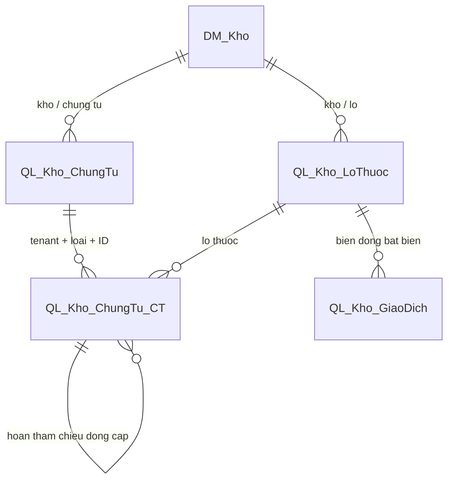

# Kho QLPM v114

Đã triển khai trên **Hieu/QLPM**, nhánh **Hieu_12/10_1**, ngày 13/10/2026. Phân hệ kho còn **5 bảng**, thay cho 17 bảng. Giao diện, route, quyền và tham số/kết quả STO hiện tại được giữ nguyên. Điều chỉnh/hủy thuốc vẫn sử dụng được qua các STO hiện có; không thêm lại màn kiểm kê, xuất khác hoặc khóa lô.

## Bảng sau khi gộp

| Bảng | Vai trò | Số dòng lúc triển khai |
|---|---|---:|
| `DM_Kho` | Danh mục kho theo cơ sở | 1 |
| `QL_Kho_LoThuoc` | Lô, hạn dùng, giá vốn và tồn vật lý | 263 |
| `QL_Kho_ChungTu` | Nhập, cấp phát, hoàn, điều chỉnh/hủy thuốc | 12 |
| `QL_Kho_ChungTu_CT` | Chi tiết của bốn loại chứng từ | 30 |
| `QL_Kho_GiaoDich` | Sổ giao dịch bất biến | 281 |

Đã chuyển 1 phiếu nhập/1 dòng, 9 phiếu cấp/23 dòng và 2 phiếu hoàn/6 dòng. Chưa có chứng từ điều chỉnh trong dữ liệu tại thời điểm gộp. Sáu bảng kiểm kê, xuất khác, khóa lô và số chứng từ được bỏ đều có 0 dòng.

Khóa chính của chứng từ và chi tiết là `(IDCSKCB, LoaiChungTu, ID)`. `LoaiChungTu` gồm `NHAP`, `CAP_PHAT`, `HOAN`, `DIEU_CHINH`; `LoaiNghiepVu` giữ phân biệt nhận trả/đảo cấp do hủy thu và điều chỉnh/hủy thuốc. ID cũ không được đổi: cùng ID giữa hai loại phiếu là hợp lệ. Có 8 sequence cấp ID riêng theo loại và cấp header/chi tiết, khởi đầu sau cả ID lớn nhất và bộ đếm identity cũ.

Ngày lập và người thực hiện dùng cột chung; tiền nhập/VAT, tổng giá vốn, giá vốn xuất, quy đổi đơn vị, số lượng đã hoàn, snapshot nhà cung cấp/thuốc/người thực hiện và liên kết nguồn thu được giữ riêng. Dòng hoàn tham chiếu chi tiết `CAP_PHAT` bằng FK có tenant và loại chứng từ. Khóa lô và hạn dùng hiện có vẫn nằm tại bảng lô.

Sổ giao dịch được giữ nguyên từng byte dữ liệu khi đối chiếu JSON; không dựng lại từ chứng từ. Các dòng số dư chuyển đổi cũ vẫn tồn tại, kể cả dòng không có ID chứng từ. Trigger mới chỉ ghi giao dịch cho chứng từ phát sinh sau khi sao chép xong. STO tiếp tục cập nhật tồn; không có trigger mới tự cộng/trừ tồn.

## Nguồn triển khai

- `59_kho_gop_chung_tu_v114.sql`: tạo bảng/constraint/index/sequence, sao chép và đối chiếu từng cột.
- `60_kho_sto_v114.sql`: nguồn tập trung cho 29 STO; 18 STO có tham chiếu bảng cũ được chuyển sang bảng chung. Các phép đọc dùng projection trực tiếp có lọc loại; không tạo view tương thích tên bảng cũ. Cấp phát, in, kiểm tra tồn khi khám, hoàn tiền và đảo cấp do hủy thu giữ contract cũ.
- `61_kho_chot_schema_v114.sql`: bỏ bảng/STO không còn dùng và tạo trigger giao dịch chung.
- `62_kho_kiem_tra_v114.sql`: kiểm tra schema, constraint, liên kết và tồn; không tạo/hủy chứng từ.
- `Invoke-KhoV114.ps1`: runner có chặn sai server/DB, kiểm tra metadata/module, backup, transaction, khóa bảng và đối chiếu SHA-256.

Các file cùng thư mục `V114` giữ phần thu ngân/khám/nhà cung cấp/CLS/quyền của các overlay cũ, bỏ phần tạo bảng và STO kho cũ. `00_CapNhat_TatCa.sql` và `20_REBUILD_ALL_STO_MAIN.sql` sử dụng các file này và nguồn STO kho v114. Hai entry point yêu cầu cutover v114 đã hoàn tất trước khi chạy; updater tổng không được dùng để thực hiện bước gộp phá hủy schema. Các script kho phiên bản cũ còn trong repository để đối chiếu lịch sử, không chạy chúng trên schema v114.

## Backup và bằng chứng triển khai

Backup native `COPY_ONLY, CHECKSUM` đã qua `RESTORE VERIFYONLY`:

`C:\Program Files\Microsoft SQL Server\MSSQL17.MSSQLSERVER\MSSQL\Backup\QLPM_before_kho_v114_20261013_164248.bak`

Manifest: [KhoV114_20261013_164248/manifest.json](../ChangeLogs/KhoV114_20261013_164248/manifest.json).

Trong cùng transaction, runner khóa bảng, đọc lại baseline, so SHA-256 của projection đủ tất cả cột của 8 bảng nguồn; kiểm tra constraint, refresh module để bắt tham chiếu/cột sai, rồi chốt phiên bản. SHA-256 và số dòng của danh mục kho, lô và giao dịch trước/sau trùng nhau. Transaction không thay đổi số lượng tồn hoặc sổ giao dịch.

Build .NET thành công: **0 lỗi**, 1 cảnh báo NETSDK1138 cho target .NET 7. Không chạy web, test tự động hoặc thử ghi nghiệp vụ. Build dùng output `tmp/build-v112` để không đụng tiến trình Visual Studio đang chạy.

## Chạy lại và quay lui

`Invoke-KhoV114.ps1` không có `-Apply` chỉ đọc. Nếu DB đã là v114, runner chỉ kiểm tra và kết thúc, không sao chép lại. Lần áp đầu tiên cần `-Apply`; runner chỉ chấp nhận Hieu/QLPM phiên bản 113, metadata/module đúng baseline đã duyệt và các bảng bỏ trống. Nếu có drift, sai quyền bảng hoặc FK mới, runner dừng để rà lại.

Quay lui được chuẩn bị bằng `Invoke-KhoV114.ps1 -Apply -Rollback`, **chưa chạy nghiệm thu rollback**. Runner yêu cầu đúng v114 và các module còn đúng bản đã triển khai, backup lại DB, khóa bảng, tạo schema cũ không có trigger, sao chép toàn bộ chứng từ hiện tại về 8 bảng, đối chiếu, khôi phục constraint/module/trigger và reseed ID. Chứng từ phát sinh sau cutover cũng được chuyển về. Tồn lô và sổ giao dịch giữ nguyên trạng thái hiện tại. Không restore backup cũ đè lên dữ liệu vận hành mới.

Khi rollback, phải dùng bộ script và snapshot đã lưu cùng lần triển khai. Nếu code/schema đã thay đổi sau đó, cần cập nhật phương án quay lui trước; runner chủ động từ chối module khác baseline. Không chạy rollback chỉ để nghiệm thu thay đổi này.

## Phần người dùng nghiệm thu

Kiểm tra tồn/bộ lọc, nhập/in/Excel/hủy nhập, cấp từng phần và in theo nhóm toa, hoàn/hủy cấp, điều chỉnh/hủy thuốc, hủy thu/đảo cấp, đọc phiếu cũ và quyền theo cơ sở. Các thao tác này chưa được xác nhận bằng runtime trong lần triển khai; chỉ thử trên dữ liệu nghiệm thu do người dùng chọn.
